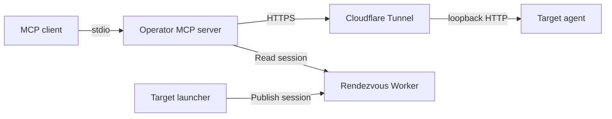

# MCP Windows Remote Shell

A small proof of concept for running shell commands on a remote Windows computer
from a local MCP client.

Copy a prepared package to the target, double-click **start-relay.cmd**, and connect
from your MCP client. The target opens an outbound Cloudflare Tunnel; you do not
need to configure SSH, forward a router port, or copy a new tunnel URL each time.

**This tool intentionally grants arbitrary command execution.** It is designed
for authorized troubleshooting, not for unattended production administration.
Read [the security model](SECURITY.md) before distributing a package.



## What it does

- Provides `current_target`, `check_agent`, and `run_command` MCP tools.
- Uses a reusable package credential. It does not expire or require renewal by
  the MCP client. Every launch creates new agent and cleanup tokens.
- Allows one active session at a time. An existing session cannot be silently
  replaced; close it before starting another. Sessions expire after 12 hours.
- Keeps a persistent session fingerprint and rejects rollback or alteration.
- Bounds request/output sizes and command timeouts; supervises child processes.
- Stops the relay and cleans up identified package files when the launcher exits.

The agent is written in Go with no third-party dependencies. The operator MCP
server and rendezvous Worker are TypeScript. The Windows package uses Windows
PowerShell 5.1 and a compiled agent; Node.js and Go are not needed on the target.

## Are administrator permissions required?

**The normal target workflow is designed to run as a standard user.** The launcher
does not request UAC elevation, install a service, change firewall rules, or change
machine-wide execution policy. Use a dedicated writable directory on a fixed local
drive. The relay and its commands run with the privileges of the account that
started it; it does not grant additional privileges.

| Operation | Permission requirements |
|---|---|
| Start the target agent and tunnel | Standard user, writable package directory, permitted outbound network access |
| Clean up the package | Permission to stop the same user's processes and remove the package's files |
| Run system administration commands | Whatever Windows permissions that command normally requires |
| Install development prerequisites | Depends on the chosen Go/Node.js/pnpm installation method and organization policy |
| Deploy your Worker | A Cloudflare account with permission to deploy Workers and Durable Objects; no OS administrator requirement |

`-ExecutionPolicy Bypass` applies to the launched PowerShell process, does not
make it an administrator, and does not override Group Policy. Managed devices
may block unsigned executables, PowerShell, CIM queries, or outbound tunnels.
The launcher fails closed when it cannot verify the agent or its port ownership.
See [permissions and platform limitations](docs/PERMISSIONS.md).

## Requirements

- **Operator workstation:** macOS is the validated operator platform; Node.js 26+
  and pnpm. The operator's private state uses POSIX ownership/permissions and
  process locking. Windows as the operator platform is not supported by this
  implementation. The Go agent itself supports Windows and Unix platforms.
- **Build:** Go 1.27+; Node.js 26+ and pnpm for the MCP server and Worker.
- **Target package:** Windows 11 x64 with Windows PowerShell 5.1. Other Windows
  versions and ARM emulation require their own validation.
- **Rendezvous:** your own Cloudflare account and deployed Worker. This repository
  does not provide a shared hosted service or public access credentials.

## Setup from source

### 1. Build and install dependencies

```sh
./agent/build.sh
cp agent/dist/relay-agent-windows-amd64.exe target-windows/

cd mcp-server
pnpm install --frozen-lockfile
pnpm run build
cd ../rendezvous
pnpm install --frozen-lockfile
cd ..
```

An optional trusted `target-windows/cloudflared.exe` can be included in the package.
Otherwise, the launcher downloads the Windows binary from Cloudflare's GitHub
releases. That download is not version/hash pinned in this POC.

### 2. Deploy your rendezvous

```sh
cd rendezvous
cp wrangler.jsonc wrangler.local.jsonc
# Set your chosen Worker name in wrangler.local.jsonc.
pnpm exec wrangler login
pnpm exec wrangler deploy --config wrangler.local.jsonc
cd ..
```

The first deployment creates the SQLite Durable Object. Session endpoints remain
unavailable until you add the secrets in the next step. Keep account-specific
configuration in the ignored local config, not in the public template.

### 3. Generate private operator configuration

Replace the example URL with the URL printed by your deployment:

```sh
mkdir -p "$HOME/relay-packages"
node scripts/setup-operator.mjs \
  --rendezvous-url https://YOUR-WORKER.YOUR-SUBDOMAIN.workers.dev \
  --package-dir "$HOME/relay-packages/relay-package"
```

This creates a private directory at `~/.config/remote-support-relay/`, containing:

- `operator.json`: operator state, provisioning key, and explicit package paths.
- `worker-secrets.json`: the Worker secrets for the next command.
- `mcp-config.json`: a client configuration snippet with the read key.

Credential values are not printed. Existing configuration is never overwritten.
You can instead use `mcp-server/operator.example.json` as a manual setup template.
Never commit any generated credential file or the prepared target package.

```sh
cd rendezvous
pnpm exec wrangler secret bulk \
  "$HOME/.config/remote-support-relay/worker-secrets.json" \
  --config wrangler.local.jsonc
cd ..
```

After a successful upload, remove the temporary `worker-secrets.json` file. Keep
`operator.json` and the private MCP configuration. Add the generated `relay`
configuration to your MCP client and restart that MCP connection once.

### 4. Export a reusable target package

```sh
cd mcp-server
pnpm run prepare-target
```

Alternatively, open **prepare-package.command**. This is a manual installation
or update action. It copies trusted local files into the configured destination,
archives an existing package directory, and preserves the package credential.
An ordinary local directory works; removable storage is optional.

The MCP server never watches a storage device or renews the credential. For an
explicit credential rotation after compromise, stop the previous session and run
`pnpm run prepare-target --force`. Redistribute the resulting package afterward.

## Use the target package

1. Copy the prepared `relay-package` directory to a dedicated writable directory
   on the target's fixed local drive. Keep your original package for future use.
2. Double-click **start-relay.cmd**. Leave its window open.
3. In your MCP client, use `check_agent`, then `run_command` as needed.
4. Press **Ctrl+C** in the target launcher to stop and clean up. Check the cleanup
   result; **cleanup.cmd** retries incomplete cleanup.
5. Reuse the same original package for the next session.

Do not launch from removable storage or a network share. Cleanup intentionally
refuses removable, network, linked, protected, or unverified locations. Files
added by the user are preserved. Cleanup is not forensic erasure and cannot
remove screenshots, backups, system logs, or copies made by another party.

## MCP configuration

The setup script writes a private client snippet. The following placeholder-only
example also shows the supported environment variables:

```json
{
  "mcpServers": {
    "relay": {
      "command": "node",
      "args": ["/ABSOLUTE/PATH/TO/mcp-windows-remote-shell/mcp-server/dist/index.js"],
      "env": {
        "RELAY_RENDEZVOUS_URL": "https://YOUR-WORKER.YOUR-SUBDOMAIN.workers.dev",
        "RELAY_RENDEZVOUS_READ_KEY": "YOUR_PRIVATE_READ_KEY",
        "RELAY_OPERATOR_STATE": "/ABSOLUTE/PATH/TO/private/operator.json"
      }
    }
  }
}
```

Optional: `RELAY_AGENT_TIMEOUT_S` (30 by default, 1–3600), and
`RELAY_HTTP_TIMEOUT_MS` (must include at least 15 seconds beyond command timeout).
For explicit static configuration, use `RELAY_URL` and `RELAY_TOKEN` instead of
rendezvous variables. HTTP is accepted only for explicitly configured loopback
static targets; all remote traffic requires HTTPS and rejects redirects.

## Development and publication

See [CONTRIBUTING.md](CONTRIBUTING.md) for checks,
[the protocol](docs/PROTOCOL.md) for endpoint details, and
[the publishing guide](docs/PUBLISHING.md) for creating a clean source export.

This project is licensed under the [MIT License](LICENSE). Never publish a
configured target package or operator credentials.
